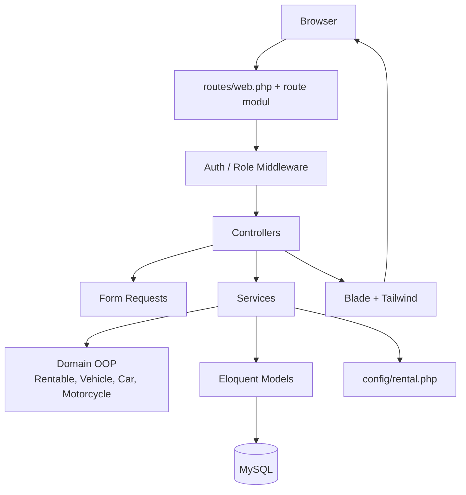
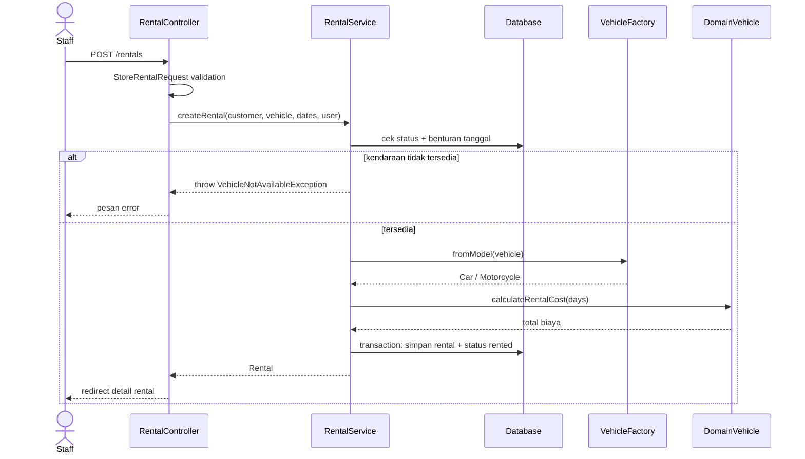
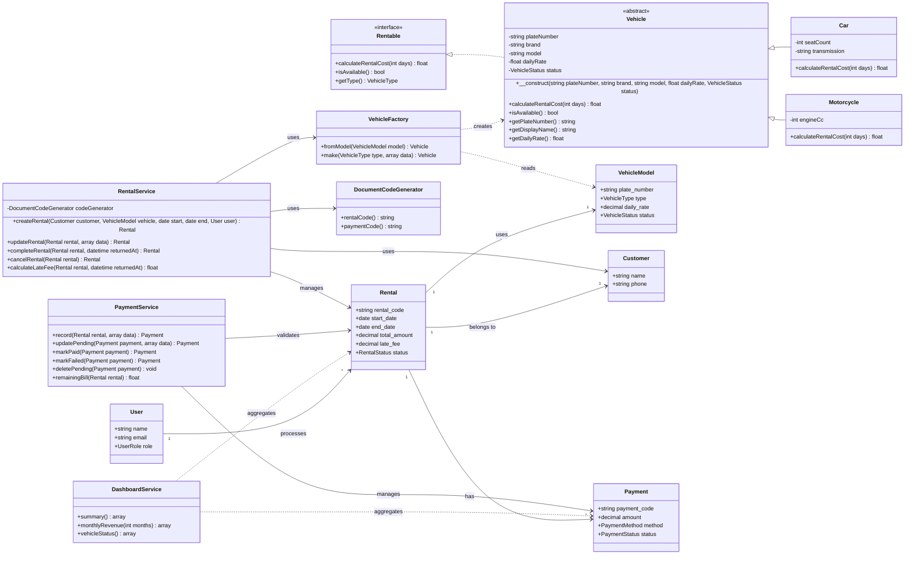
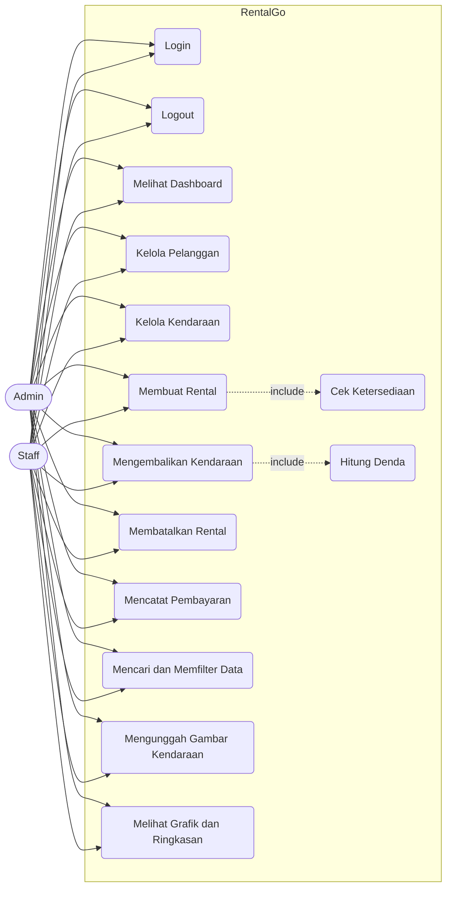

# Arsitektur RentalGo

Dokumen ini menjelaskan arsitektur aplikasi yang **direncanakan**. Tidak ada class, migration,
controller, service, atau view yang dibuat pada Phase 0.

## 1. Tujuan dan Prinsip

1. **MVC sederhana** — route → controller → service/model → Blade view.
2. **OOP yang dapat dijelaskan** — class domain kecil, eksplisit, dan mudah dipahami saat presentasi.
3. **Pemisahan tanggung jawab** — validasi di Form Request, bisnis rental di service, persistensi di Eloquent.
4. **Tidak overengineering** — tanpa repository pattern generik, DDD, CQRS, event sourcing, atau microservice.
5. **Siap kolaborasi** — folder dan route dipisah per modul agar empat anggota tidak saling menimpa file.
6. **Satu sumber aturan bisnis** — tarif, denda, dan aturan rental dipusatkan di domain/service dan `config/rental.php`.

## 2. Gambaran Layer



| Layer | Isi | Tanggung Jawab |
|---|---|---|
| Presentation | Routes, middleware, controllers, Form Requests, Blade | Menerima request, validasi, menampilkan response |
| Application | `RentalService`, `PaymentService`, `DashboardService`, `VehicleImageService` | Mengorkestrasi use case dan transaction |
| Domain | `Rentable`, abstract `Vehicle`, `Car`, `Motorcycle`, enum, exception, factory | Aturan dan perilaku kendaraan |
| Persistence | Eloquent models, migrations, factories, seeders | Pemetaan database dan relasi |
| Cross-cutting | `config/rental.php`, provider, middleware role | Konfigurasi dan kebijakan lintas layer |

## 3. Struktur Direktori Rencana

```text
app/
├── Contracts/
│   └── Rentable.php                     # Phase 1
├── Domain/
│   └── Vehicles/
│       ├── Vehicle.php                  # abstract, Phase 1
│       ├── Car.php                      # Phase 1
│       ├── Motorcycle.php               # Phase 1
│       └── VehicleFactory.php           # Phase 1
├── Enums/
│   ├── UserRole.php                     # Phase 1
│   ├── VehicleType.php                  # Phase 1
│   ├── VehicleStatus.php                # Phase 1
│   ├── RentalStatus.php                 # Phase 1
│   ├── PaymentMethod.php                # Phase 1
│   └── PaymentStatus.php                # Phase 1
├── Exceptions/
│   ├── VehicleNotAvailableException.php # Phase 1
│   └── UnsupportedVehicleTypeException.php # Phase 1
├── Http/
│   ├── Controllers/
│   │   ├── Auth/AuthController.php      # Phase 2 (operator)
│   │   ├── Customer/CustomerAuthController.php    # Phase 2 (login/registrasi pelanggan)
│   │   ├── Customer/CustomerProfileController.php # Phase 2 (profil pelanggan)
│   │   ├── Customer/CustomerRentalController.php  # Phase 2 (booking & riwayat pelanggan)
│   │   ├── DashboardController.php      # Phase 2 (Admin/Staff)
│   │   ├── PortalController.php         # Phase 2 (katalog publik)
│   │   ├── CustomerController.php       # Phase 3
│   │   ├── VehicleController.php        # Phase 3
│   │   ├── RentalController.php         # Phase 4
│   │   └── PaymentController.php        # Phase 4
│   ├── Middleware/
│   │   └── EnsureUserIsAdmin.php        # Phase 2
│   └── Requests/
│       ├── Auth/LoginRequest.php        # Phase 2 (operator)
│       ├── Customer/CustomerLoginRequest.php        # Phase 2
│       ├── Customer/CustomerRegisterRequest.php     # Phase 2
│       ├── Customer/CustomerBookingRequest.php      # Phase 2
│       ├── Customer/UpdateCustomerProfileRequest.php # Phase 2
│       ├── StoreCustomerRequest.php     # Phase 3
│       ├── UpdateCustomerRequest.php    # Phase 3
│       ├── StoreVehicleRequest.php      # Phase 3
│       ├── UpdateVehicleRequest.php     # Phase 3
│       ├── StoreRentalRequest.php       # Phase 4
│       ├── UpdateRentalRequest.php      # Phase 4
│       ├── ReturnRentalRequest.php      # Phase 4
│       ├── StorePaymentRequest.php      # Phase 4
│       └── UpdatePaymentRequest.php     # Phase 4
├── Models/
│   ├── User.php                         # Phase 1 (extend skeleton)
│   ├── Customer.php                     # Phase 1
│   ├── Vehicle.php                      # Phase 1 (Eloquent)
│   ├── Rental.php                       # Phase 1
│   └── Payment.php                      # Phase 1
├── Services/
│   ├── RentalService.php                # Phase 1 (dipakai Phase 4)
│   ├── PaymentService.php               # Phase 4
│   ├── DashboardService.php             # Phase 2
│   └── VehicleImageService.php          # Phase 3
└── Support/
    └── DocumentCodeGenerator.php        # Phase 1

config/
└── rental.php                           # Phase 1

database/
├── factories/                           # Phase 1
├── migrations/                          # Phase 1
└── seeders/                             # Phase 1

routes/
├── web.php                              # Phase 1/2 (include route modul)
├── auth.php                             # Phase 2
├── customer.php                         # Phase 2 (portal pelanggan & katalog publik)
├── dashboard.php                        # Phase 2
├── master.php                           # Phase 3
└── rental.php                           # Phase 4

resources/views/
├── layouts/app.blade.php                # Phase 2 (Admin/Staff)
├── layouts/public.blade.php             # Phase 2 (Publik & Pelanggan)
├── components/                          # Phase 2
├── auth/                                # Phase 2
├── dashboard/                           # Phase 2
├── portal/                              # Phase 2 (katalog & detail kendaraan publik)
├── customer/                            # Phase 2 (riwayat rental & profil pelanggan)
├── customers/                           # Phase 3
├── vehicles/                            # Phase 3
├── rentals/                             # Phase 4
└── payments/                            # Phase 4
```

Catatan: file di atas adalah **rencana**. Phase 0 tidak membuat file aplikasi.

## 4. Alur Request — Membuat Rental

1. Staff mengirim `POST /rentals` dengan pelanggan, kendaraan, tanggal mulai, dan tanggal selesai.
2. `StoreRentalRequest` memvalidasi input dan tipe data.
3. `RentalController` memanggil `RentalService::createRental()`.
4. `RentalService` mengunci baris kendaraan (`lockForUpdate`) dan memeriksa status serta benturan tanggal rental aktif di dalam transaksi.
5. `VehicleFactory` mengubah Eloquent `Vehicle` menjadi domain `Car` atau `Motorcycle`.
6. Domain object menghitung biaya melalui `calculateRentalCost()` (polymorphism).
7. `RentalService` membuat rental dan mengubah status kendaraan dalam satu database transaction.
8. Controller mengarahkan ke halaman detail rental dengan pesan sukses.
9. Jika kendaraan tidak tersedia, exception domain ditangkap dan ditampilkan sebagai error yang ramah.



## 5. Model Domain dan Tanggung Jawab Class

### 5.1 Pemisahan Domain dan Eloquent

Ada dua class bernama `Vehicle`:

- `App\Models\Vehicle` — **Eloquent model** untuk tabel `vehicles`.
- `App\Domain\Vehicles\Vehicle` — **abstract domain class** untuk perilaku kendaraan.

Pemisahan ini disengaja agar:

- Eloquent tetap sederhana dan mudah dipakai untuk CRUD.
- Inheritance dan polymorphism benar-benar terjadi pada object domain, bukan dipaksakan pada
  single-table Eloquent inheritance yang sulit dijelaskan.
- Aturan harga kendaraan dapat diuji tanpa database.

Saat digunakan di service, Eloquent model diimpor dengan alias:

```php
use App\Models\Vehicle as VehicleModel;
use App\Domain\Vehicles\Vehicle;
```

`VehicleFactory::fromModel(VehicleModel $model): Vehicle` memetakan `type` ke `Car` atau `Motorcycle`.

### 5.2 Tanggung Jawab Class

| Class/Type | Layer | Tanggung Jawab | Property Penting | Method Penting | Relasi | Konsep OOP |
|---|---|---|---|---|---|---|
| `App\Contracts\Rentable` | Domain | Kontrak kendaraan yang dapat disewakan | — | `calculateRentalCost(int $days)`, `isAvailable()`, `getType()` | Diimplementasikan `Vehicle` | Abstraction (interface) |
| `App\Domain\Vehicles\Vehicle` | Domain | Menyimpan state kendaraan, validasi input, perilaku umum | `plateNumber`, `brand`, `model`, `dailyRate`, `status` (private/protected) | constructor, `calculateRentalCost()` abstract, `isAvailable()`, getter | Parent dari `Car`/`Motorcycle` | Abstraction, encapsulation, constructor |
| `App\Domain\Vehicles\Car` | Domain | Perilaku dan harga mobil | `seatCount`, `transmission` | override `calculateRentalCost()` | `extends Vehicle` | Inheritance, polymorphism |
| `App\Domain\Vehicles\Motorcycle` | Domain | Perilaku dan harga motor | `engineCc` | override `calculateRentalCost()` | `extends Vehicle` | Inheritance, polymorphism |
| `App\Domain\Vehicles\VehicleFactory` | Domain | Membuat domain object dari Eloquent model | — | static `fromModel()`, static `make()` | Membuat `Vehicle`, membaca `VehicleModel` | Static method, factory, exception |
| `App\Services\RentalService` | Application | Membuat, mengubah, mengembalikan, membatalkan rental; cek availability; hitung denda; transaksi + row lock | `config/rental.php` | `createRental()`, `updateRental()`, `completeRental()`, `cancelRental()`, `calculateLateFee()` | Menggunakan `VehicleFactory`, `Rental`, `Customer`, `VehicleModel` | Encapsulation, constructor injection, exception |
| `App\Services\PaymentService` | Application | Mencatat/mengubah pembayaran pending, mark paid/failed, hapus pending, validasi sisa tagihan | — | `record()`, `updatePending()`, `markPaid()`, `markFailed()`, `deletePending()`, `remainingBill()` | `Payment`, `Rental` | Service layer, transaction, exception |
| `App\Services\DashboardService` | Application | Menghitung statistik dan data grafik | — | `summary()`, `monthlyRevenue()`, `vehicleStatus()` | `Rental`, `Payment`, `VehicleModel` | Service layer, reusable |
| `App\Services\VehicleImageService` | Application | Menyimpan/menghapus gambar kendaraan | disk, folder | `store()`, `delete()` | `VehicleModel`, Storage | Encapsulation |
| `App\Support\DocumentCodeGenerator` | Support | Membuat kode rental/pembayaran unik | prefix | static `rentalCode()`, static `paymentCode()` | `Rental`, `Payment` | Static method |
| `VehicleNotAvailableException` | Exception | Menandai kendaraan tidak tersedia | — | static `forVehicle()` | Dilempar `RentalService` | Exception |
| `UnsupportedVehicleTypeException` | Exception | Menandai tipe kendaraan tidak dikenal | — | static `forType()` | Dilempar `VehicleFactory` | Exception |
| `User`, `Customer`, `VehicleModel`, `Rental`, `Payment` | Persistence | Relasi, cast, scope, accessor | Kolom tabel | Relasi Eloquent, scope | Saling berelasi | Encapsulation (`#[Fillable]`, `#[Hidden]`, cast) |
| `UserRole`, `VehicleType`, `VehicleStatus`, `RentalStatus`, `PaymentMethod`, `PaymentStatus` | Domain | Nilai status/tipe yang type-safe | case | `label()`, helper | Digunakan model/service | Type safety, reusable |

### 5.3 Aturan Domain

- `Vehicle` constructor menolak tarif harian <= 0 dan hari sewa < 1.
- `Car::calculateRentalCost()` = `dailyRate × days + 10% asuransi`.
- `Motorcycle::calculateRentalCost()` = `dailyRate × days`, diskon 10% jika `days >= 7`.
- `RentalService` menghitung denda 50% tarif harian per hari terlambat.
- Semua nominal dibulatkan ke dua desimal.
- Semua aturan angka berasal dari `config/rental.php`, bukan magic number tersebar.

## 6. Class Diagram



Catatan: method static dan abstract ditandai di dokumentasi tabel, bukan dengan notasi khusus
Mermaid, agar diagram mudah dirender di GitHub.

## 7. Use Case Diagram



Perbedaan hak akses:

- Admin dapat menghapus data master (soft delete) dan seluruh aksi operasional.
- Staff dapat membuat/mengubah data operasional, tetapi aksi hapus data master dibatasi.
- Pelanggan dapat mendaftar/login melalui portal publik, menjelajahi katalog kendaraan, membuat booking mandiri, melihat riwayat rental & pembayaran pribadinya, membatalkan rental aktif pribadinya, serta mengelola profilnya. Pelanggan tidak dapat mengakses `/dashboard` atau modul operasional Admin/Staff.

## 8. Arsitektur UI

- Layout utama: `resources/views/layouts/app.blade.php` (sidebar/navbar responsif).
- Komponen reusable: `x-alert`, `x-button`, `x-card`, `x-input`, `x-modal`, `x-pagination`, `x-status-badge`.
- Tailwind CSS 4 melalui Vite.
- Chart.js ditambahkan pada Phase 2 untuk grafik dashboard.
- Semua label UI berbahasa Indonesia.
- Validasi ditampilkan di dekat field terkait; error global memakai alert.
- Tabel data memakai komponen pagination dan empty state yang konsisten.

## 9. Keamanan

| Aspek | Rencana |
|---|---|
| Password | Hash bawaan Laravel (`bcrypt`) |
| Session | Regenerate setelah login; invalidate setelah logout |
| CSRF | Middleware default Laravel + token pada form |
| Otorisasi | Middleware `auth`; middleware role untuk aksi Admin |
| Mass assignment | `#[Fillable]`/`#[Guarded]` dan Form Request |
| Validasi | Form Request server-side untuk semua input |
| XSS | Escaping Blade (`{{ }}`) |
| Upload | Validasi MIME, ukuran, dan ekstensi gambar |
| Secret | `.env` tidak di-commit; dokumentasi memakai placeholder |
| Error | Pesan ramah; detail exception hanya di log lokal |

## 10. Strategi Testing

| Level | Cakupan | Contoh |
|---|---|---|
| Unit | Domain pricing, validasi constructor, factory, code generator | `CarTest`, `MotorcycleTest`, `VehicleFactoryTest` |
| Feature | Migrasi/relasi, auth, CRUD, rental lifecycle, pembayaran | `RentalServiceTest`, `AuthTest`, `VehicleCrudTest` |
| Manual | Responsive UI, alur demo, upload gambar, grafik | Checklist Phase 5 |

- Menggunakan PHPUnit 12, `RefreshDatabase`, factory, dan SQLite in-memory.
- Setiap fase wajib menambah test untuk fitur yang dikerjakan.
- `php artisan test` harus lulus sebelum PR.

## 11. Penyederhanaan yang Disengaja

Hal-hal berikut sengaja **tidak** digunakan agar proyek tetap dapat dipahami dan dijelaskan:

- Repository pattern generik dan interface untuk setiap model.
- Domain-Driven Design aggregates, value objects kompleks, CQRS, event sourcing.
- SPA/React/Vue; UI memakai Blade + Tailwind.
- Laravel Breeze/Jetstream; auth dibuat sederhana agar konsep session terlihat.
- Docker (keputusan pemilik proyek).
- API layer kecuali bonus REST API sederhana di Phase 5.
- Notifikasi real-time dan payment gateway.

## 12. Pemetaan OOP ke Requirement UAS

| Requirement | Implementasi Rencana | Bukti |
|---|---|---|
| UAS-OOP-01 ≥8 class | 16 class + 1 interface + 6 enum | Class diagram + hitung class |
| UAS-OOP-02 Encapsulation | Private/protected domain property, getter, `#[Fillable]`/`#[Hidden]`, private service dependency | Code review |
| UAS-OOP-03 ≥2 inheritance | `Car extends Vehicle`, `Motorcycle extends Vehicle` | Unit test + diagram |
| UAS-OOP-04 Polymorphism | Override `calculateRentalCost()`; service menerima `Vehicle` | Unit test polimorfik |
| UAS-OOP-05 Abstraction | `Rentable` interface + abstract `Vehicle` | Diagram + review |
| UAS-OOP-06 Constructor | Constructor domain class + DI service/controller | Review |
| UAS-OOP-07 Static method | `VehicleFactory::fromModel()`, `DocumentCodeGenerator::rentalCode()` | Unit test |
| UAS-OOP-08 Namespace | PSR-4 `App\...` | `composer dump-autoload` |
| UAS-OOP-09 try-catch | Custom exception + try-catch di factory/service | Unit test |

## 13. Konvensi Penamaan

- Class: `PascalCase`; method/property: `camelCase`; tabel/kolom: `snake_case`.
- Domain class: `App\Domain\...`; persistence: `App\Models\...`.
- Enum: nama singular (`VehicleType`, `RentalStatus`).
- Controller: `XxxController`; Form Request: `StoreXxxRequest`/`UpdateXxxRequest`.
- Route name: `module.action` (contoh `vehicles.index`, `rentals.store`).
- View: `resources/views/module/action.blade.php`.
- Commit: Conventional Commits (`feat:`, `fix:`, `docs:`, `test:`, `refactor:`, `chore:`).
