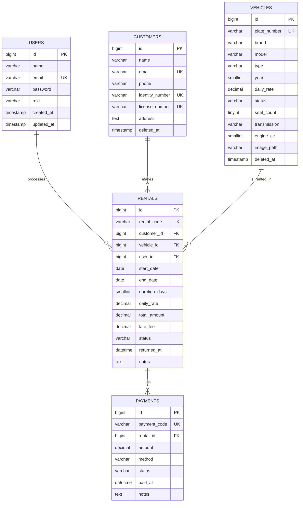

# Skema Database RentalGo

Dokumen ini merancang database untuk aplikasi rental kendaraan. **Belum ada migration atau
perubahan database yang dibuat pada Phase 0.**

## 1. Prinsip Desain

1. **MySQL sebagai database utama** sesuai kebutuhan UAS; SQLite hanya untuk automated test.
2. Nama tabel plural, nama kolom `snake_case`, primary key `id` (`BIGINT UNSIGNED`).
3. Uang menggunakan `DECIMAL(12,2)`; tidak menggunakan `FLOAT`.
4. Relasi memakai foreign key dan index.
5. Data master pelanggan dan kendaraan memakai **soft delete** untuk menjaga riwayat.
6. Transaksi rental tidak dihapus permanen; pembatalan memakai status.
7. Status disimpan sebagai `VARCHAR` dan divalidasi oleh enum PHP agar kompatibel dengan MySQL
   maupun SQLite.
8. Timestamps `created_at`/`updated_at` disediakan Laravel untuk semua tabel.

## 2. Ringkasan Tabel

| No | Tabel | Fungsi | Soft Delete |
|---|---|---|---|
| 1 | `users` | Akun Admin/Staff untuk login | Tidak |
| 2 | `customers` | Data pelanggan rental | Ya |
| 3 | `vehicles` | Data mobil/motor yang disewakan | Ya |
| 4 | `rentals` | Transaksi penyewaan | Tidak (pakai status) |
| 5 | `payments` | Pembayaran untuk rental | Tidak (hapus hanya pending) |

Tabel bawaan Laravel (`password_reset_tokens`, `sessions`, `cache`, `cache_locks`, `jobs`,
`job_batches`, `failed_jobs`) tidak dihitung sebagai tabel bisnis. Lima tabel bisnis sudah melebihi
minimum empat tabel UAS.

## 3. Detail Tabel

### 3.1 `users`

| Kolom | Tipe | Null | Default | Constraint | Keterangan |
|---|---|---:|---|---|---|
| `id` | BIGINT UNSIGNED | No | auto | PK | ID akun |
| `name` | VARCHAR(100) | No | — | — | Nama Admin/Staff |
| `email` | VARCHAR(150) | No | — | UNIQUE | Login |
| `email_verified_at` | TIMESTAMP | Yes | NULL | — | Bawaan Laravel |
| `password` | VARCHAR(255) | No | — | — | Hash password |
| `role` | VARCHAR(20) | No | `staff` | index | `admin` atau `staff` (khusus operator) |
| `remember_token` | VARCHAR(100) | Yes | NULL | — | Bawaan Laravel |
| `created_at` | TIMESTAMP | Yes | NULL | — | — |
| `updated_at` | TIMESTAMP | Yes | NULL | — | — |

### 3.2 `customers`

| Kolom | Tipe | Null | Default | Constraint | Keterangan |
|---|---|---:|---|---|---|
| `id` | BIGINT UNSIGNED | No | auto | PK | ID pelanggan (terpisah dari `users.id`) |
| `name` | VARCHAR(100) | No | — | index | Nama lengkap |
| `email` | VARCHAR(150) | Yes | NULL | UNIQUE | Email (login portal pelanggan) |
| `password` | VARCHAR(255) | Yes | NULL | — | Hash password portal (opsional bila dibuat operator) |
| `remember_token` | VARCHAR(100) | Yes | NULL | — | Remember token guard `customer` |
| `phone` | VARCHAR(20) | No | — | index | Nomor telepon |
| `identity_number` | VARCHAR(30) | No | — | UNIQUE | NIK/KTP |
| `license_number` | VARCHAR(30) | No | — | UNIQUE | Nomor SIM |
| `address` | TEXT | Yes | NULL | — | Alamat |
| `created_at` | TIMESTAMP | Yes | NULL | — | — |
| `updated_at` | TIMESTAMP | Yes | NULL | — | — |
| `deleted_at` | TIMESTAMP | Yes | NULL | index | Soft delete |

### 3.3 `vehicles`

| Kolom | Tipe | Null | Default | Constraint | Keterangan |
|---|---|---:|---|---|---|
| `id` | BIGINT UNSIGNED | No | auto | PK | ID kendaraan |
| `plate_number` | VARCHAR(15) | No | — | UNIQUE | Nomor polisi |
| `brand` | VARCHAR(50) | No | — | — | Merek |
| `model` | VARCHAR(50) | No | — | — | Model |
| `type` | VARCHAR(20) | No | — | index | `car` atau `motorcycle` |
| `year` | SMALLINT UNSIGNED | No | — | — | Tahun kendaraan |
| `daily_rate` | DECIMAL(12,2) | No | — | >= 0 | Tarif harian |
| `status` | VARCHAR(20) | No | `available` | index | `available`, `rented`, `maintenance` |
| `seat_count` | TINYINT UNSIGNED | Yes | NULL | — | Khusus mobil |
| `transmission` | VARCHAR(20) | Yes | NULL | — | Khusus mobil: `manual`, `automatic` |
| `engine_cc` | SMALLINT UNSIGNED | Yes | NULL | — | Khusus motor |
| `image_path` | VARCHAR(255) | Yes | NULL | — | Path gambar di storage publik |
| `description` | TEXT | Yes | NULL | — | Deskripsi |
| `created_at` | TIMESTAMP | Yes | NULL | — | — |
| `updated_at` | TIMESTAMP | Yes | NULL | — | — |
| `deleted_at` | TIMESTAMP | Yes | NULL | index | Soft delete |

Index komposit: `(type, status)` untuk filter daftar kendaraan.

### 3.4 `rentals`

| Kolom | Tipe | Null | Default | Constraint | Keterangan |
|---|---|---:|---|---|---|
| `id` | BIGINT UNSIGNED | No | auto | PK | ID rental |
| `rental_code` | VARCHAR(20) | No | — | UNIQUE | Kode transaksi, contoh `RNT-20261125-A1B2` |
| `customer_id` | BIGINT UNSIGNED | No | — | FK → `customers.id`, RESTRICT | Pelanggan |
| `vehicle_id` | BIGINT UNSIGNED | No | — | FK → `vehicles.id`, RESTRICT | Kendaraan |
| `user_id` | BIGINT UNSIGNED | Yes | NULL | FK → `users.id`, RESTRICT | Admin/Staff pemroses (`NULL` jika booking mandiri pelanggan) |
| `start_date` | DATE | No | — | index | Tanggal mulai |
| `end_date` | DATE | No | — | index | Tanggal selesai |
| `duration_days` | SMALLINT UNSIGNED | No | — | >= 1 | Snapshot durasi inklusif |
| `daily_rate` | DECIMAL(12,2) | No | — | >= 0 | Snapshot tarif harian |
| `total_amount` | DECIMAL(12,2) | No | — | >= 0 | Total biaya sewa |
| `late_fee` | DECIMAL(12,2) | No | 0 | >= 0 | Denda keterlambatan |
| `status` | VARCHAR(20) | No | `active` | index | `active`, `completed`, `cancelled` |
| `returned_at` | DATETIME | Yes | NULL | — | Waktu pengembalian |
| `notes` | TEXT | Yes | NULL | — | Catatan |
| `created_at` | TIMESTAMP | Yes | NULL | — | — |
| `updated_at` | TIMESTAMP | Yes | NULL | — | — |

Index komposit: `(vehicle_id, status)` untuk cek ketersediaan; `(start_date, end_date)` untuk
filter tanggal dan deteksi overlap.

### 3.5 `payments`

| Kolom | Tipe | Null | Default | Constraint | Keterangan |
|---|---|---:|---|---|---|
| `id` | BIGINT UNSIGNED | No | auto | PK | ID pembayaran |
| `payment_code` | VARCHAR(20) | No | — | UNIQUE | Kode pembayaran, contoh `PAY-20261125-C3D4` |
| `rental_id` | BIGINT UNSIGNED | No | — | FK → `rentals.id`, RESTRICT | Rental terkait |
| `amount` | DECIMAL(12,2) | No | — | > 0 | Nominal |
| `method` | VARCHAR(20) | No | — | index | `cash`, `transfer` |
| `status` | VARCHAR(20) | No | `pending` | index | `pending`, `paid`, `failed`, `cancelled` |
| `paid_at` | DATETIME | Yes | NULL | — | Waktu lunas |
| `notes` | TEXT | Yes | NULL | — | Catatan |
| `created_at` | TIMESTAMP | Yes | NULL | — | — |
| `updated_at` | TIMESTAMP | Yes | NULL | — | — |

## 4. ERD



## 5. Relasi dan Kardinalitas

| Relasi | Kardinalitas | Foreign Key | On Delete | Penjelasan |
|---|---|---|---|---|
| User → Rental | 1 : N | `rentals.user_id` | RESTRICT | Satu staff memproses banyak rental (`NULL` untuk booking mandiri) |
| Customer → Rental | 1 : N | `rentals.customer_id` | RESTRICT | Satu pelanggan dapat memiliki banyak rental |
| Vehicle → Rental | 1 : N | `rentals.vehicle_id` | RESTRICT | Satu kendaraan memiliki riwayat banyak rental |
| Rental → Payment | 1 : N | `payments.rental_id` | RESTRICT | Satu rental dapat memiliki beberapa pembayaran |

Tidak ada relasi many-to-many pada versi minimum. Relasi di atas sudah memenuhi requirement
"relasi database" UAS.

## 6. Enum dan Transisi Status

| Enum PHP | Nilai | Digunakan pada |
|---|---|---|
| `UserRole` | `admin`, `staff` | `users.role` |
| `VehicleType` | `car`, `motorcycle` | `vehicles.type` |
| `VehicleStatus` | `available`, `rented`, `maintenance` | `vehicles.status` |
| `RentalStatus` | `active`, `completed`, `cancelled` | `rentals.status` |
| `PaymentMethod` | `cash`, `transfer` | `payments.method` |
| `PaymentStatus` | `pending`, `paid`, `failed`, `cancelled` | `payments.status` |

Transisi status:

```text
Vehicle:  available <-> maintenance
          available  -> rented
          rented     -> available   (complete/cancel)
          maintenance -> available  (selesai perawatan)

Rental:   active -> completed
          active -> cancelled
          completed/cancelled bersifat final

Payment:  pending -> paid
          pending -> failed
          pending -> cancelled      (saat rental dibatalkan)
          paid/failed/cancelled bersifat final
```

## 7. Index dan Alasan

| Tabel | Index | Alasan |
|---|---|---|
| `users` | `UNIQUE(email)`, `INDEX(role)` | Login dan filter role |
| `customers` | `UNIQUE(email)`, `UNIQUE(identity_number)`, `UNIQUE(license_number)`, `INDEX(name)`, `INDEX(phone)` | Pencarian dan validasi unik |
| `vehicles` | `UNIQUE(plate_number)`, `INDEX(type)`, `INDEX(status)`, `INDEX(type, status)` | Filter dan daftar kendaraan |
| `rentals` | `UNIQUE(rental_code)`, `INDEX(customer_id)`, `INDEX(vehicle_id)`, `INDEX(user_id)`, `INDEX(status)`, `INDEX(start_date)`, `INDEX(end_date)`, `INDEX(vehicle_id, status)` | Riwayat, filter, cek overlap |
| `payments` | `UNIQUE(payment_code)`, `INDEX(rental_id)`, `INDEX(status)`, `INDEX(method)`, `INDEX(paid_at)` | Rekap pembayaran dan dashboard |

## 8. Alur Rental dan Dampak Database

### 8.1 Membuat Rental

1. Validasi tanggal: `end_date >= start_date`.
2. Cek kendaraan `status = available`.
3. Cek overlap:

```sql
SELECT COUNT(*)
FROM rentals
WHERE vehicle_id = :vehicle_id
  AND status = 'active'
  AND start_date <= :end_date
  AND end_date >= :start_date;
```

4. Hitung `duration_days`, `daily_rate` snapshot, dan `total_amount`.
5. Database transaction:
   - `INSERT rentals` dengan status `active`.
   - `UPDATE vehicles SET status = 'rented'`.

### 8.2 Pengembalian

1. Hitung hari terlambat setelah `end_date`.
2. `late_fee = 50% × daily_rate × late_days`.
3. `UPDATE rentals` set `status = completed`, `returned_at`, `late_fee`.
4. `UPDATE vehicles` set `status = available`.

### 8.3 Pembatalan

1. Hanya rental `active`.
2. `UPDATE rentals` set `status = cancelled`.
3. `UPDATE vehicles` set `status = available`.
4. `UPDATE payments` set `status = cancelled` untuk pembayaran `pending`.

### 8.4 Pembayaran

1. Hitung total tagihan = `total_amount + late_fee`.
2. Hitung total pembayaran `paid`.
3. Tolak pembayaran baru jika `paid + amount > total tagihan`.
4. Pembayaran baru default `pending`; saat dilunasi set `paid` dan `paid_at`.
5. Pembayaran `paid` tidak dapat diedit/dihapus.

## 9. Constraint dan Validasi

Constraint yang dijaga di aplikasi (Form Request/domain service):

- Tarif harian > 0.
- Tahun kendaraan masuk akal (1980–tahun berjalan + 1).
- Mobil memiliki `seat_count`/`transmission`; motor memiliki `engine_cc`.
- `end_date >= start_date`.
- `duration_days >= 1`.
- Total dan denda tidak negatif.
- Pembayaran > 0 dan tidak melebihi sisa tagihan.
- Kendaraan maintenance/tidak tersedia tidak dapat disewakan.
- Pelanggan/kendaraan dengan rental aktif tidak dapat dihapus.
- Pembayaran paid/failed/cancelled tidak dapat diubah.

Database constraint yang tetap dipasang:

- Primary key, unique, foreign key.
- Default value.
- `nullable` sesuai desain.
- Index untuk kolom pencarian/filter.

MySQL CHECK constraint bersifat opsional karena perbedaan dukungan SQLite; aturan tetap divalidasi
di PHP agar test dan produksi konsisten.

## 10. Rencana Seed Data

Seeder dibuat pada Phase 1 dan dipakai seluruh fase:

| Data | Jumlah | Catatan |
|---|---|---|
| Admin | 1 | `admin@rentalgo.test` / password dev |
| Staff | 1 | `staff@rentalgo.test` / password dev |
| Pelanggan | 8–10 | Nama, telepon, NIK, SIM valid secara format |
| Kendaraan | 8–10 | 4 mobil, 4 motor; status bervariasi |
| Rental | 12–15 | Kombinasi active/completed/cancelled, tanggal 6 bulan terakhir |
| Pembayaran | 10–15 | Kombinasi pending/paid/failed untuk dashboard |

Aturan:

- Password demo hanya untuk lokal; tidak dipakai di produksi.
- Seeder harus idempoten atau dijalankan dengan `migrate:fresh --seed`.
- Data seed harus mendukung grafik dashboard enam bulan.
- Nama dan data fiktif; tidak memakai data pribadi nyata.

## 11. MySQL vs SQLite

| Aspek | MySQL | SQLite (test) |
|---|---|---|
| Koneksi | `DB_CONNECTION=mysql` | `DB_CONNECTION=sqlite`, `:memory:` |
| Engine | InnoDB, utf8mb4 | File/in-memory |
| Enum | Disimpan sebagai `VARCHAR` | `VARCHAR` |
| Decimal | Presisi tetap | Afinitas numerik; nilai uang di-cast |
| Foreign key | Didukung | Perlu `PRAGMA foreign_keys=ON` (Laravel mengaktifkan) |
| Tanggal | `DATE`, `DATETIME` | Teks ISO |
| SQL dump | `mysqldump` | Tidak menjadi deliverable |

Prinsip: gunakan schema builder Laravel dan Eloquent, hindari SQL khusus MySQL di kode aplikasi.
Dengan demikian test SQLite tetap relevan, sementara demo akhir menggunakan MySQL.

## 12. Rencana Migration Phase 1

Urutan yang direncanakan:

1. `add_role_to_users_table` — menambahkan `role` dan index.
2. `create_customers_table`.
3. `create_vehicles_table`.
4. `create_rentals_table` — FK ke customers, vehicles, users.
5. `create_payments_table` — FK ke rentals.
6. `add_auth_columns_to_customers_and_nullable_user_id_on_rentals` (Phase 2) — menambah `password`/`remember_token` pada `customers` untuk guard `customer` dan menjadikan `rentals.user_id` nullable.

Catatan:

- Migrasi bawaan Laravel untuk users, cache, jobs, sessions tetap dipakai; panjang string terindeks
  disesuaikan dengan batas key MySQL lokal (ADR-026).
- Phase 1 menjalankan `php artisan migrate:fresh --seed` di database lokal.
- Tidak ada data produksi yang perlu dipertahankan.
- Migration harus dapat di-rollback dengan `down()` yang benar.

## 13. Deliverable SQL (Phase 5)

UAS meminta database SQL. Rencana:

1. Setelah aplikasi stabil di MySQL, jalankan seeder.
2. Buat dump:

```bash
mysqldump -u root rentalgo > database/schema/rentalgo.sql
```

3. Simpan juga versi schema-only jika diperlukan:

```bash
mysqldump -u root --no-data rentalgo > database/schema/rentalgo-schema.sql
```

4. Dokumentasikan cara import:

```bash
mysql -u root -p -e "CREATE DATABASE rentalgo CHARACTER SET utf8mb4 COLLATE utf8mb4_unicode_ci;"
mysql -u root rentalgo < database/schema/rentalgo.sql
```

5. Verifikasi dengan mengimpor ulang ke database kosong dan menjalankan smoke test.

File SQL **tidak dibuat pada Phase 0**.

## 14. Pemetaan ke Requirement UAS

| Requirement | Bukti Rencana |
|---|---|
| Minimal 4 tabel | 5 tabel bisnis: users, customers, vehicles, rentals, payments |
| Relasi database | 4 foreign key 1:N dengan constraint |
| CRUD database | Tabel mendukung pelanggan, kendaraan, rental, pembayaran |
| Database SQL | Dump MySQL di Phase 5 |
| Dashboard statistik | Agregasi rentals/payments/vehicles |
| Validasi | Constraint aplikasi + validasi form |
| OOP | Eloquent models + domain classes terpisah |
